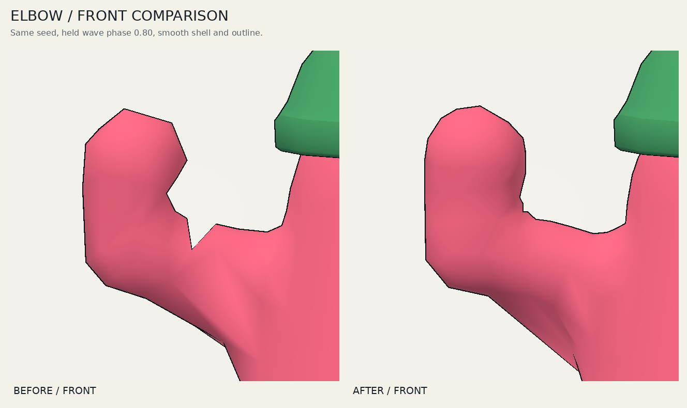

# Duder Lab

An offline WebGL2 workbench for parametric bean characters, wearable meshes, procedural skins, animation, and rigid-body ragdolls. Current version: **V3.4.4 — Clay Wardrobe**.

Together with [Duderworld](https://github.com/TrentSterling/duderworld), Duder Lab develops reusable content for future **Tront EOS lobby demos and minigame samples**. Duder Lab handles the characters, wearables, rigs, and animation; Duderworld handles the environments and level geometry. The browser previews support rapid inspection and mesh export for eventual integration into Unity and Tront EOS projects.

**Scope:** Duder Lab is a browser prototyping lab, not a web game. It is plain WebGL2 with cannon-es physics (no Three.js), and the hosted page is a development preview for inspecting and comparing iterations. Approved meshes get converted to Unity locally later; this repository holds no Unity project, EOS networking, or gameplay code.



[Watch the updated wave from three angles](docs/media/v3-2-1-wave.mp4) · [See the separated legs](docs/media/v3-2-1-legs-before-after.png)

## Run

[Open the hosted Duder Lab preview](https://trentsterling.github.io/duderlab/) · [Standalone HTML](https://trentsterling.github.io/duderlab/static.html) · [Duderworld preview](https://trentsterling.github.io/duderworld/)

Download this repository and open **`static.html`** in a browser with WebGL2 enabled. It works directly from `file://`; the page contains its JavaScript, physics engine, shaders, and glyph atlas. No server, package installation, CDN, or network request is required.

The editable implementation is in `src/`. `static.html` is the built, self-contained distribution.

## Controls

| Control | Action |
| --- | --- |
| `M` | Open Idle, Walk, Wave, and Dance animations |
| `B` | Drop a pile of beans; choose 4, 8, 12, or 16 in Physics |
| `P` | Release the current animation to a ragdoll, or pause active physics |
| `S` | Start the two-duder sumo demo |
| Space | Pause or resume animation/physics |
| Left-drag a body | Grab; release to throw |
| Right-drag | Orbit the camera |
| Mouse wheel | Zoom |
| `X` / `O` | Toggle rig overlay / shell outlines |
| `D` / `K` | Drop or refill / kick |
| `G` / `F` | Switch Gallery/Focus / frame the view |
| `R` / Shift+`R` | Reroll one duder / restore the original collection |

## Rebuild

Python 3 is the only build dependency:

```sh
python3 build.py
```

On Windows, `py -3 build.py` works with the Python launcher. The script writes `static.html`, `duder-lab-v3-4-4.html`, and `dist/index.html`. UTF-8 is explicit, and the output directory is created automatically.

### Hosted preview

The [Pages workflow](.github/workflows/pages.yml) builds from `src/` on pushes to `main` and can also be run manually from `main`. It runs `python3 qa/check-build.py` to verify exact source embedding, JavaScript syntax, identical offline builds, and the absence of external runtime dependencies. The deployment contains only `dist/index.html` and a byte-identical `dist/static.html` alias for saving an offline copy.

GitHub Pages uses **Settings → Pages → Build and deployment → Source: GitHub Actions**. The workflow uses the `github-pages` environment and official GitHub Actions pinned to release commits. Its build job has read access to repository contents; only its deployment job receives Pages and deployment-token write permissions. The hosted build uses the same meshes, shaders, controls, and exports as `static.html`.

## V3.4.4: restored Clay Wardrobe source

The saved **Duder-Lab-3.4.4-offline.html** from October 26, 2026 contained newer work than the GitHub source. Its eleven embedded modules have been recovered exactly, and `python3 build.py` reproduces that saved HTML byte for byte (SHA-256 `7fcd9eeee5c62533a3a6a58050c45e4259948905f5182c8e3aad56e552a1029d`).

This preserves eleven hat silhouettes, adjustable larger eyes, tee and overalls outfits, separate hat/frame colors, eyewear fit improvements, clay lighting, body-outline tail rejection, and camera framing for tall hats. The body shell, rig, wave motion, physics, and arm-weight implementation match the earlier source. The V3.2.1 and earlier proof sections below document those historical releases.

## V3.2.1: A-pose binding, soft elbows, and separate legs

The raised elbow in V3.2 developed a sharp V-shaped bite. Its rest arm was already bent, and capsule-distance weights changed abruptly around the overlapping ends of the upper arm and forearm. The wave folded several local triangles inward even though the vertices were welded and the skinning preserved volume.

- **Open A-pose bind.** Forearms now continue along the upper-arm axis. The rest shell begins with a clean, straight elbow, while the existing shoulder placement and arm-clearance calculation keep the arms outside the torso.
- **Anatomical elbow weights.** Each arm's total influence is retained, but its upper-arm/forearm split follows a smooth longitudinal transition through the elbow. The transition scales with arm thickness and is fixed in the rest mesh. It does not slide around the surface during animation.
- **Retuned greeting.** The shoulder solve presents the mitten beside the face using less elbow flex from the straight bind. The same four-second preparation, lift, two sweeps, hold, and settle remain. Animation and physics share the new stable hinge frame; no wrist body or extra skeleton joint was added.
- **Better body sampling.** A finer regular SDF lattice keeps long underarm triangles from producing large outline tails after posing. Smooth shading, welded vertices, and the existing hat-outline shader are retained.
- **Visible lower-leg separation.** Leg spacing now accounts for foot radius, body width, and the extra thickness introduced by SDF blending. Narrow beans with large feet retain two rounded legs. Editing Blend also refreshes the animation's cached rest rig.
- **The existing rendering batches.** All character surfaces still use one indexed fill and one indexed shell draw. Stage and GPU UI bring the total to four; the rig overlay adds one. Seven rigid bodies remain per duder.

The [V3.2.1 gallery](docs/media/v3-2-1-gallery-ui.png) contains **46,248 triangles, 23,526 indexed vertices, and 2,907,576 bytes of geometry buffers across 16 beans**, with four total draws. The denser body mesh uses more triangles than V3.2; it adds no material or render pass. These are geometry/storage counts, not a hardware frame-rate measurement.

The new regressions reproduce the exact screenshot seed at all three facet levels, check posed triangle orientation through the wave, inspect actual shader close-ups, and measure the leg gap in the baked triangle mesh. The leg checks cover the rest pose and mild idle; ragdoll contacts can naturally bring feet together. Very large close-ups, especially at the lowest detail, can still show short underarm occlusion-contour endpoints; this release fixes the deep elbow notch and the long default side-view tail.

## V3.2: softer arms and a readable greeting

The old wave curled the forearm toward the camera, making it appear short and sharply bent from the front. V3.2 follows the approved concept: the hand rises beside the face on the viewer's left, the elbow stays outside the torso, and the forearm makes two small side-to-side sweeps.

- **Softer rest shape.** The upper arm slopes farther downward, the elbow keeps a fuller cross-section, and the rounded hand end is wider. Clearance includes that larger hand, preserving the underarm gap.
- **A shared elbow frame.** A stable blend of outward and forward bend axes is defined once in the rig and used by both animation and ragdoll constraints. The waving shoulder rolls and swings independently within its existing limits.
- **A greeting fitted to each recipe.** At recipe setup, the shoulder orientation is solved so the forearm points upward with a small forward component. The arm keeps its original lengths; no moving hinge axis, extra wrist, or new rigid body is needed.
- **A four-second loop.** A small preparation leads into the lift, two forearm sweeps, a held greeting, and a gentle settle. The shoulder remains quiet during the sweeps, with a small delayed body lean. Motion amount above one increases the sweep without lifting the shoulder beyond its safe pose.
- **Volume-preserving skinning.** Body vertices now blend dual quaternions instead of linearly blending matrices, reducing elbow collapse at large bends. Fixed rest-space weights and the existing two bounded SDF corrections remain. The GPU and posed GLB bake use the same deformation. Rigid accessories keep their original matrix transforms.
- **Accurate pose data.** The shared pose sampler now explicitly uses high precision in both shader stages. The actual GPU pose and CPU export agree to less than one millionth of a world unit in the verified cases.
- **Closed geometry at the smallest settings.** Very short, thin arms with minimum spacing and blend can need a finer SDF lattice to resolve the underarm gap. Two extra refinement retries handle that corner without changing ordinary recipes or loosening the closed-mesh checks.
- **The same batches.** Bodies, eyes, and gear still share one indexed fill draw and one indexed outline draw. Stage and GPU glyph UI make four total draws; the rig overlay adds one. Quaternion data fits in unused columns of the existing pose texture. No material, render pass, texture allocation, or rigid body was added.

Press **M**, select **Wave**, and use the timeline to inspect a pose. **X** shows the bones; **P** releases the current pose and momentum into a ragdoll. [This recipe](docs/examples/wave-study.json) recreates the pink duder with a green beanie used in the proof images; import it with the JSON import control.

The [V3.2 gallery](docs/media/v3-2-gallery-ui.png) uses 28,392 triangles, 14,598 indexed vertices, and 1,800,504 bytes of geometry buffers. These are storage counts, not a hardware performance measurement.

The [actual rig views](docs/media/v3-2-wave-rig.png) show the same seven-bone hierarchy used for physics. The V3.1.1 wearable geometry and hat-outline rules are retained.

## V3.1.1: connected hat outlines

The pink duder with a green beanie, seed `1702468274`, exposed a defect that closed-mesh topology checks did not catch: a detached dark stroke below the hat hem, with pink body pixels visible between them.

- The beanie crown and folded cuff now form **one continuous closed surface**, while the darker cuff tint is preserved. Two microscopic reentrant notches at the join are removed so their back faces cannot poke through the shell as dark dots. A gently tapered extrusion at the bottom crease prevents the narrow bevel from folding over at thick outline settings.
- All five hollow main hat shapes keep their **inner/contact loops unexpanded**. Only exterior vertices move outward. The underside triangles stretch between those loops, maintaining coverage beneath the visible hem.
- The cap visor uses the same fixed contact arc, including its shared tapered endpoints, so its underside stays connected at the maximum outline width.
- Outline weight is interpolated across those triangles. A flat per-face value could discard a whole bridging triangle based on its last vertex.
- Anchored vertices also retain their original depth; the shell depth bias applies to expanded vertices. This prevents the head from occluding a thin contact strip at low viewing angles.
- The existing indexed fill and outline batches are retained: **four total draws**, or five with the rig overlay. No render pass, texture, or buffer was added for this repair.

The new rendered regression uses the exact reported recipe and checks for pink pixels between the green hem and dark stroke. It also checks that the stroke remains present. Geometry verification now explicitly requires a single connected beanie and matching outline weights at its color seams.

## Smooth shading and welded geometry

- Smooth shading is enabled by default for the body and all gear. The Preview toggle still provides flat shading.
- Coincident positions are canonicalized before shared normals are calculated. Accessories use angle-weighted normals across adjacent faces and color boundaries; the body retains its SDF gradient normals.
- Compatible vertex records are welded into indexed buffers. Both the fill and outline use `drawElements` on the same character batch. Color, material, and skinning boundaries keep any distinct attributes they need, while matching positions and smooth normals stay aligned.
- The cap visor now tapers to exact shared endpoints, closing the gaps at its two ends. Solid sunglass lenses now include their missing perimeter walls. Revolved seams and poles use exact shared coordinates.
- GLB export also welds matching position, normal, and color records and writes an indexed mesh. The current shading choice and posed shape are preserved.

For the [default 16-duder gallery](docs/media/v3-1-1-gallery.png), the same V3.1.1 mesh has the following storage cost:

| Geometry layout | Vertex records | Geometry buffer bytes |
| --- | ---: | ---: |
| Expanded triangle layout | 84,408 | 9,453,696 |
| Indexed normal rendering | 14,470 | 1,784,632 |

That is **82.9% fewer vertex records** and **81.1% less GPU geometry-buffer storage**, including the index buffer. This comparison excludes textures and UI buffers. Wireframe mode lazily uploads an additional expanded copy because barycentric wire edges require per-triangle attributes. These are storage measurements, not hardware FPS claims.

The body and wearables remain separate, closed components where appropriate. The beanie crown and cuff are one continuous surface; other trim, cap brims, and the body retain their separate components. The complete duder is not a single watertight CAD object.

The [cap comparison](docs/media/v3-1-cap-comparison.png) and [bucket-hat comparison](docs/media/v3-1-bucket-comparison.png) show V3 above V3.1 from three angles.

## Implementation

- A connected Surface Nets body follows seven bones using dual-quaternion skinning. Bounded SDF correction repairs blended joint regions without accumulating projection drift.
- Procedural skin patterns sample rest-space coordinates.
- Each ragdoll has seven bodies and six joints. Cannon-es runs at a fixed 120 Hz simulation step.
- Pile mode uses smaller collision proxies and staggered spawns; its optional 16-bean setting has 112 rigid bodies and 96 joints.
- Shell outlines use shared smooth extrusion normals after geometry assembly. Fill and outline geometry share the indexed render path.
- Bodies, eyes, and accessories share one fill draw. The stage, outline, and GPU glyph UI bring the total to four draws. The optional rig overlay adds one. More beans still increase physics and triangle work.
- JSON exports retain editable recipes. GLB exports bake the current pose into one static mesh/material; runtime joints and a glTF skeleton are not exported.

## Verification

The JavaScript checks use Node's built-in modules, with no npm dependencies:

```sh
node qa/check-app-events.mjs
node qa/check-shell.mjs
node qa/check-animation.mjs
node qa/check-bind-pose.mjs
node qa/check-elbow-deformation.mjs
node qa/check-leg-clearance.mjs
node qa/check-wave-handoff.mjs
node qa/check-dual-quaternion.mjs --cpu-only
node qa/check-physics.mjs
node qa/check-pile.mjs
node qa/check-outline-weld.mjs
node qa/check-hat-topology.mjs
node qa/check-hat-contact-outline.mjs
node qa/check-welded-mesh.mjs
node qa/check-ui-v3.mjs
```

Current results are in `docs/verification/v3-2-1/`. V3.2 wave, skinning, interaction, build, and render results remain in `docs/verification/v3-2/`. The new wave checks cover held forearm direction, hand/body clearance, fixed bone lengths, quiet elbow, loop continuity, actual joint limits, and 70 releases across seven body shapes. Dual-quaternion checks compare the CPU export with the actual shipped vertex shader using GLES transform feedback. The wave study and video replay the actual shaders from fixed cameras.

Earlier results are retained in `docs/verification/v3-1-1/`, `docs/verification/v3-1/`, and `docs/verification/v3/`. V3.1.1 verification includes 43 application interactions, 46 hat-contact geometry cases, 45 hat topology variants, 102 gear/dimension combinations and indexed GLB reconstruction, and 53 actual GLES renders covering the reported outline defect, every hat style, and the complete gallery. Earlier animation, physics, and responsive UI reports remain available. The interaction harness mocks DOM/WebGL transport; it does not replace a browser test. Software GLES rendering separately validates the actual shaders, element buffers, and visible outline behavior.

[Watch or download the V3 motion proof](docs/media/duder-v3-motion.mp4). It replays actual application shaders and simulation using software GLES. It is not a hardware FPS benchmark.

### Optional software rendering

The wave study and three-camera video use the same software renderer:

```sh
python3 qa/check-build.py
python3 qa/render-wave-study.py
python3 qa/render-elbow-study.py --baseline /path/to/v3.2/checkout
node qa/capture-leg-study.mjs --baseline /path/to/v3.2/checkout --output output/leg-study
python3 qa/render-leg-study.py output/leg-study
python3 qa/render-wave-motion.py output/wave.mp4 --fps 24 --loops 2
node qa/check-dual-quaternion.mjs
```

Pass `--baseline /path/to/v3.2/checkout` to `render-wave-study.py` for a before/after sheet. The GPU parity check uses transform feedback from the shipped vertex shader, not a hand-written substitute.


The still-image regression uses Node, Python with Pillow, and Linux/WSL Mesa EGL/GLES (`libEGL.so.1`). It renders the actual shaders and checks the reported hat-outline defect without a physical GPU:

```sh
python3 qa/check-hat-outline-render.py
```

Pass `--baseline /path/to/v3.1/checkout` to also reproduce the old defect and create before/after images. The baseline must contain the editable source and QA tools, not just the standalone HTML.

The motion-video workflow additionally requires FFmpeg with libx264:

```sh
python3 qa/render-motion.py output/pile.mp4 --mode pile --frames 108 --fps 12 --width 960 --height 720
```

Supported modes: `idle`, `walk`, `wave`, `dance`, `ragdoll`, `sumo`, and `pile`. Raw captures and temporary render output are intentionally ignored by Git.

## Credits and bundled notices

- SDF blend-shell technique adapted from [Trent Sterling's Critters](https://github.com/TrentSterling/critters), with its GOOBERS / u/AntiqueFeedback7447 and RujiK provenance retained in the source.
- [Cannon-es](https://github.com/pmndrs/cannon-es), version 0.20.0: its MIT license is included in `src/vendor-cannon.js` and the generated HTML.
- [DejaVu Sans](https://dejavu-fonts.github.io/): font notices are included in `src/font-data.js` and the generated HTML.

No project-wide open-source license has been assigned. The bundled third-party notices continue to apply to their respective components.
