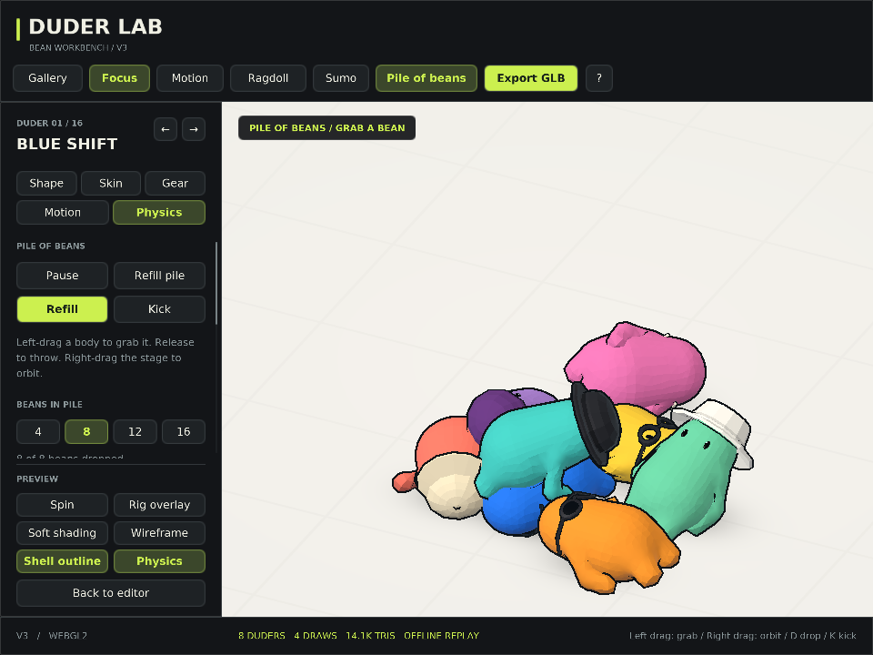

# Duder Lab

An offline WebGL2 workbench for parametric bean characters, wearable meshes, procedural skins, animation, and rigid-body ragdolls. Current baseline: **V3**.



## Run

Download this repository and open **`static.html`** in a browser with WebGL2 enabled. It works directly from `file://`; the page contains its JavaScript, physics engine, shaders, and glyph atlas. No server, package installation, CDN, or network request is required.

The editable implementation is in `src/`. `static.html` is the built, self-contained distribution.

## Controls

| Control | Action |
| --- | --- |
| `M` | Open Idle, Walk, Wave, and Dance animations |
| `B` | Drop a pile of beans; choose 4, 8, 12, or 16 in Physics |
| `P` | Release the current animation to a ragdoll, or pause active physics |
| `S` | Start the two-duder sumo demo |
| Space | Pause or resume animation/physics |
| Left-drag a body | Grab; release to throw |
| Right-drag | Orbit the camera |
| Mouse wheel | Zoom |
| `X` / `O` | Toggle rig overlay / shell outlines |
| `D` / `K` | Drop or refill / kick |
| `G` / `F` | Switch Gallery/Focus / frame the view |
| `R` / Shift+`R` | Reroll one duder / restore the original collection |

## Rebuild

Python 3 is the only build dependency:

```sh
python3 build.py
```

On Windows, `py -3 build.py` works with the Python launcher. The script writes `static.html`, `duder-lab-v3.html`, and `dist/index.html`. UTF-8 is explicit, and the output directory is created automatically.

## Implementation

- A connected Surface Nets body follows seven bones. Bounded SDF correction repairs blended joint regions without accumulating projection drift.
- Procedural skin patterns sample rest-space coordinates.
- Each ragdoll has seven bodies and six joints. Cannon-es runs at a fixed 120 Hz simulation step.
- Pile mode uses smaller collision proxies and staggered spawns; its optional 16-bean setting has 112 rigid bodies and 96 joints.
- V3 outlines use a shared-position extrusion-normal weld after geometry assembly. Flat lighting normals remain separate. This is not a Boolean union of the body and wearables.
- Bodies, eyes, and accessories share one fill draw. The stage, outline, and GPU glyph UI bring the total to four draws. The optional rig overlay adds one. More beans still increase physics and triangle work.
- JSON exports retain editable recipes. GLB exports bake the current pose into one static mesh/material; runtime joints and a glTF skeleton are not exported.

## Verification

The JavaScript checks use Node's built-in modules, with no npm dependencies:

```sh
node qa/check-app-events.mjs
node qa/check-shell.mjs
node qa/check-animation.mjs
node qa/check-physics.mjs
node qa/check-pile.mjs
node qa/check-outline-weld.mjs
node qa/check-ui-v3.mjs
```

V3's recorded results are in `docs/verification/`. They cover 43 application interactions, shell connectivity and skin weights, animation continuity, ragdoll/pile stability, 90 wearable/detail combinations, and responsive UI routes. The interaction harness mocks DOM/WebGL transport; it does not replace a browser test.

[Watch or download the V3 motion proof](docs/media/duder-v3-motion.mp4). It replays actual application shaders and simulation using software GLES. It is not a hardware FPS benchmark.

### Optional software rendering

The capture tools use Node, Python with Pillow, FFmpeg with libx264, and Linux/WSL Mesa EGL/GLES (`libEGL.so.1`). They do not require a physical GPU:

```sh
python3 qa/render-motion.py output/pile.mp4 --mode pile --frames 108 --fps 12 --width 960 --height 720
```

Supported modes: `idle`, `walk`, `wave`, `dance`, `ragdoll`, `sumo`, and `pile`. Raw captures and temporary render output are intentionally ignored by Git.

## Credits and bundled notices

- SDF blend-shell technique adapted from [Trent Sterling's Critters](https://github.com/TrentSterling/critters), with its GOOBERS / u/AntiqueFeedback7447 and RujiK provenance retained in the source.
- [Cannon-es](https://github.com/pmndrs/cannon-es), version 0.20.0: its MIT license is included in `src/vendor-cannon.js` and the generated HTML.
- [DejaVu Sans](https://dejavu-fonts.github.io/): font notices are included in `src/font-data.js` and the generated HTML.

No project-wide open-source license has been assigned. The bundled third-party notices continue to apply to their respective components.
