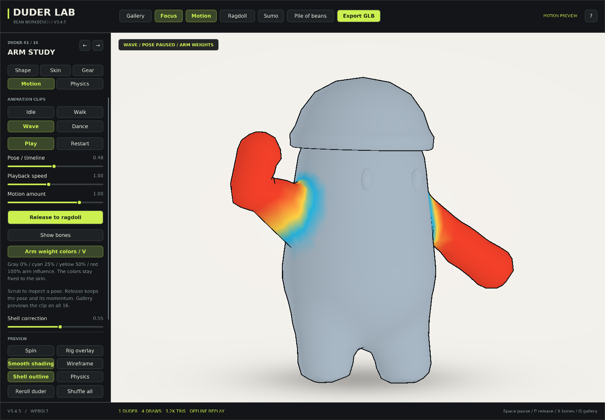
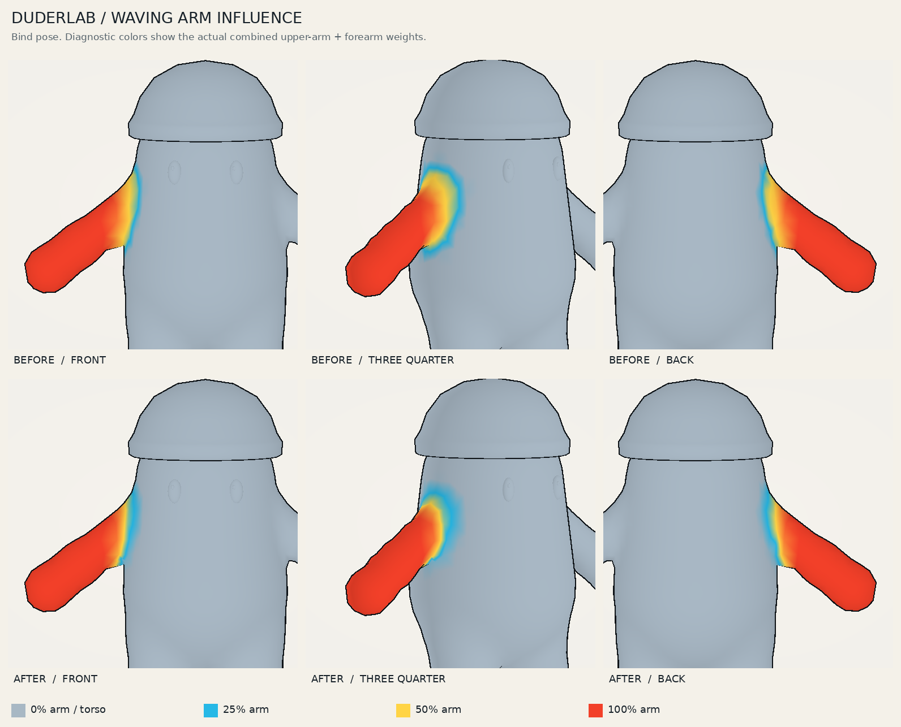
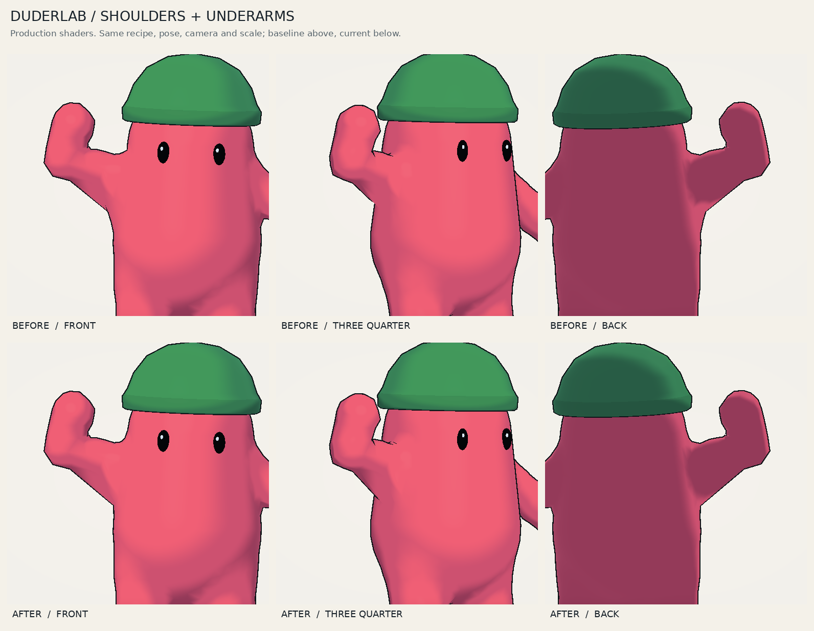

# DuderLab arm study: V3.4.5

The wave was pulling torso vertices because the bind weights treated a nearby arm capsule as an eligible owner of the body surface. A focused local shoulder envelope substantially reduces that movement while retaining the existing wave and elbow bend.

## Start the study

Open `duder-lab-arm-study.html` directly in a WebGL2 browser. It is self-contained and starts the pink reference duder waving, with the Motion panel open.

- **V** switches between the surface and actual arm-weight colors.
- **Space** pauses or resumes the wave. The **Pose / timeline** slider scrubs it.
- **X** displays the seven-bone rig.
- Right-drag orbits; the wheel zooms.
- **Shell correction** at zero isolates bone skinning from the bounded SDF repair.

The live color view combines both arms' upper-arm and forearm influences. Gray means zero, cyan 25%, yellow 50%, and red 100%. The fixed comparison sheet isolates the waving arm for clarity. The study uses a separate local-storage key so recipe edits do not overwrite the regular workbench's collection.



## Source baseline

GitHub contained V3.2.1 at commit `3247fe31070cd010ca60ff6bfa66eab538de692b`. The saved **Duder-Lab-3.4.4-offline.html**, modified October 26, 2026, contained newer wardrobe and presentation work. Its eleven source modules were recovered, and the recovered build reproduces that original HTML byte for byte:

`7fcd9eeee5c62533a3a6a58050c45e4259948905f5182c8e3aad56e552a1029d`

That recovery is a separate commit before the arm changes. It preserves the eleven hats, larger adjustable eyes, tee/overalls, independent hat/frame colors, eyewear fit, clay shading, outline-tail handling, and tall-hat framing.

The body primitives, rig definition, and weight function were identical in V3.2.1 and V3.4.4. All final A/B images use **V3.4.4 before and V3.4.5 after**, with the same recipe, camera, pose phase, and rendering style.

## Diagnosis

The original envelope chose a nearest capsule, then allowed that capsule's adjacency list to supply other influences. Its global distance span was `max(0.065, blend * 0.72)`. This could reach across the underarm gap onto the ribs. The nearest-capsule change also changed which candidates were eligible.

After selecting arm influences, the elbow pass redistributed them along the arm. This preserved a smooth elbow, but it also handed some mistakenly acquired torso vertices to the forearm. Short, thin arms at high blend were especially revealing: the conservative torso region reached 24.7% forearm influence before the repair.

This was isolated with dual-quaternion skinning and surface correction disabled. The comparison subtracts a control pose whose arm bones are locked to the same torso transform, so the intentional body lean and grounding remain in both sides. A torso vertex moving in that comparison is moving because of the arm influence.

## Implemented change

1. **One region per complete arm.** Upper-arm and forearm capsule distances are grouped before assigning region weights, removing the nearest-bone adjacency switch at their boundary.
2. **A feathered local shoulder collar.** The torso shares arm movement around the actual shoulder attachment. The falloff scales with arm radius and tapers to zero on the torso side beyond 3.5 radii.
3. **Surface ownership outside that collar.** A hanging arm across an air gap cannot acquire a torso vertex merely because it is nearby. Removed influence returns to the torso.
4. **The original elbow split.** Each arm's accepted influence is still divided smoothly along its fixed bind-space elbow axis. The strongest four influences are normalized, with the dominant influence first for dual-quaternion blending.

These weights are generated once with the mesh. The shader and GLB pose bake use the same stored attributes. The skeleton, wave motion, physics bodies, base mesh, and projection limits retain their previous implementation. The live weight-color view adds no draw call, material, texture, or geometry buffer.

## Measured result

The protected-torso fixture is selected from the bind geometry, independently of the new weighting formula: torso-nearest vertices within 0.008 body-width units of its surface and at least 2.75 upper-arm radii from either shoulder. The closer shoulder/underarm band is reported separately because some local tissue must move.

The table measures the maximum arm-induced displacement across isolated left/right shoulder raises, forward reaches, elbow bends, and nine wave phases. Values are **world units**, not hardware performance measurements.

| Body recipe | Maximum torso drift before | After | Reduction |
| --- | ---: | ---: | ---: |
| default | 0.035410 | 0.002857 | 91.9% |
| reported-wave | 0.073796 | 0.005833 | 92.1% |
| thin-short-high-blend | 0.183355 | 0.002860 | 98.4% |
| thin-long-high-blend | 0.144266 | 0.002860 | 98.0% |
| wide-short-thick | 0.000000 | 0.000000 | Already stable |
| deep-body | 0.100086 | 0.008098 | 91.9% |
| flat-body | 0.148213 | 0.006347 | 95.7% |
| minimum-blend | 0.085053 | 0.004479 | 94.7% |

For the reference wave, the held-pose CPU bake with default surface correction improves from **0.032939 to 0.002387 units** of protected-torso displacement. Across the eight fixtures, maximum protected arm influence falls from **46.95% to 3.14%**; a small soft shoulder transition remains intentional.

The reference character has **3,232 triangles, 1,676 indexed vertices, and 206,384 bytes of geometry buffers** both before and after. It uses three scene draws, or four with the GPU UI. The optional rig overlay adds its existing draw.

## Visual evidence





[Watch the matched four-second wave](media/v3-4-5-arm-wave.mp4) · [Inspect the wave keyframes](media/v3-4-5-arm-keyframes.png)

The weight change is clearer in motion and in the influence map than in a single held silhouette. The fully raised three-quarter pose still shows a low-poly underarm crease. This is a repaired influence leak and a reviewable shoulder study, not a claim that the entire shoulder shape is finished.

## Experiments not retained

| Experiment | Observed result | Decision |
| --- | --- | --- |
| A tighter shoulder boundary | Strong torso isolation, sharper lower attachment | Use a softer local feather |
| Broader global or longitudinal blending | Spread the fold and could scallop the upper shoulder | Keep smoothing local to the attachment |
| Removing position projection or field-normal blending | Lower underarm bridge remained | Keep the previous projection behavior |
| Raising the correction cap to 0.07, 0.12, or 0.18 | Mostly affected the upper shoulder; did not solve the lower bridge | Keep the existing 0.035 cap |
| Six passes of connected weight diffusion | Softened an edge but spread a polygonal fold | Do not diffuse the shipped weights |
| A globally finer SDF lattice | Improved the transition, but one diagnostic grew from 2,664 to 9,376 triangles | Avoid a global density increase |
| Local midpoint subdivision, with and without tangential relaxation | More samples exposed the remaining crease without a decisive visual benefit | Retain existing topology for this study |

The remaining geometry work should shape the chest/back-to-upper-arm attachment and its underarm edge flow. Blanket weight smoothing is not a substitute for that surface design.

## Verification and reproduction

The checked-in [verification directory](verification/v3-4-5/) records source hashes and scope. Verification includes eight torso fixtures, 27 full-arm triangle-orientation cases at three detail settings, weight normalization and continuity, welded-vertex agreement, and CPU-export versus actual GLES vertex-shader transform feedback.

The A/B proof replays the actual application shaders, attributes, indices, and pose palette on software GLES. The diagnostic influence frames explicitly use a replacement color shader. The live weight view is also checked through its production shader. These are renderer and application-harness checks, not a GPU/Quest performance benchmark.

From the arm-study commit, create a baseline checkout of its preceding recovery commit, then run:

```sh
git worktree add /tmp/duderlab-v344 HEAD^
python3 qa/check-build.py
node qa/check-arm-influence.mjs --baseline /tmp/duderlab-v344
node qa/check-dual-quaternion.mjs
node qa/check-app-events.mjs
node qa/check-arm-study-view.mjs
node qa/check-animation.mjs
python3 qa/render-arm-study.py --baseline /tmp/duderlab-v344 --output output/arm-study --video
```

Node checks use built-in modules. Shader replay additionally uses Python, Pillow, Mesa EGL/GLES, and ffmpeg for the video. Large intermediate draw traces stay outside the committed deliverables.
