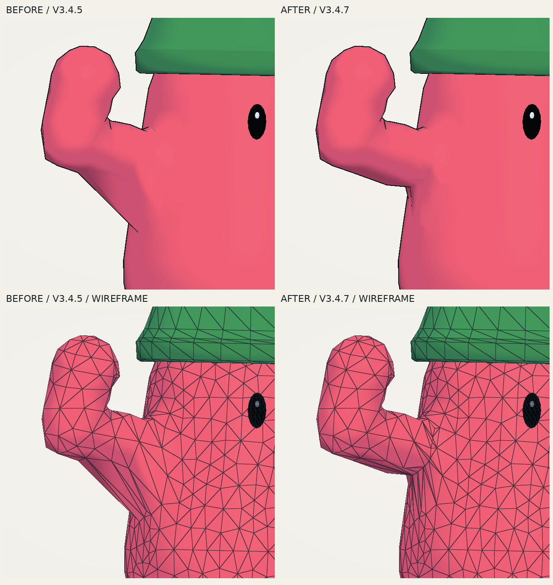

# DuderLab V3.4.7: one local shoulder loop

The V3.4.6 reconstruction overshot the requested fix. It replaced the whole arm with dense rings and introduced a narrow shoulder root. This revision removes that construction and makes a local edit to the original V3.4.5 mesh.

## Actual surface and topology

The comparison uses the same recipe, wave time, camera, material, and lighting. The upper pair shows normal shading; the lower pair shows the actual wireframe.

[Four-second wave comparison](media/v3-4-7-shoulder-wave.mp4) · [Front, three-quarter, and back](media/v3-4-7-shoulder-surface.png)

The large diagonal underarm web is reduced. The arm keeps its original thickness and hand shape, and the narrow socket from V3.4.6 is removed. The result still has the original low-poly character and some faceting around the join. It is a focused improvement, not a claim that every possible shoulder shape is perfectly crease-free.

## What changed

The existing full-body Surface Nets mesh remains the starting point. Each arm receives one shared contour through its 50% influence transition. Only triangles crossed by that contour are split. The lower part of the new loop slides toward the shoulder so the bend has an intermediate row of vertices instead of one long diagonal span.

Every original body vertex stays in place and keeps its original skin influences. New vertices interpolate their edge endpoints' per-bone weights, transfer the new shoulder row's forearm share to the upper arm, and normalize the strongest four. A cut close to an existing endpoint reuses that vertex when the requested slide is small. Deep underarm cuts keep their new point. This removes tiny sliver triangles without removing the row that carries the bend. This matters because re-evaluating the distance envelope at an inserted midpoint can produce a substantially different influence from the surrounding mesh. Normals are recomputed only on the new band and its shared boundary.

The original rig, wave animation, forearms, hands, torso sampling, legs, eyes, and accessories remain. This adds no material, draw pass, skeleton bone, or physics body.

## Why the first local trials still broke

Simply splitting the old edge left the low attachment visible. Moving existing torso vertices upward crowded their unchanged neighbors and produced folded faces, so those trials were rejected.

The accepted change moves only the newly inserted loop points. The old positional SDF correction then tried to push those points back into the former attachment, producing an overlap in identity and settling poses. Genuinely new loop vertices now bypass only that positional repair. Original and reused vertices keep the previous correction, and the normal blend remains in place.

This is a per-vertex surface tag. All copies of a shared new point get the same tag and weights, including in triangles that also contain original vertices. It does not disable repair for an entire face, which would make neighboring copies separate. CPU baking uses the same rule, and neutral export preserves the stored rest surface.

The remaining thin black line was produced by the outline pass. A narrower facing threshold applies only where torso and arm influences overlap. It reduces the inward tail and tapers the final short section of the underarm line. Pure torso, pure arm, and elbow-only blends retain their existing threshold; the filled surface is unchanged by this outline adjustment.

## Scope and cost on the reported fixture

| Measure | Original V3.4.5 | Rejected V3.4.6 | Local V3.4.7 |
| --- | ---: | ---: | ---: |
| Body triangles | 2,176 | 5,212 | 2,262 |
| Total triangles | 3,232 | 6,268 | 3,318 |
| Added indexed rendering vertices relative to V3.4.5 | 0 | 1,608 | 43 |
| Draws including GPU UI | 4 | 4 | 4 |
| Physics bodies | 7 | 7 | 7 |

The local edit adds **86 triangles, or 2.66%** of the original total. All **1,090 original body positions**, their influences, metadata, and held-wave positions match the original fixture. Only 50 original normals in the cut strip change. All 2,009 wholly distant original faces and all 1,056 eye/accessory triangles are identical. These are geometry and submission counts, not hardware frame-rate measurements.

## Why the previous socket pinched

V3.4.6 narrowed the socket to 75% of the arm radius and pinned the surrounding collar. Its rings preserved their circumference under skinning, but the inner side of the first moving band compressed sharply against that fixed join. The surface relaxation happened before the new socket was constructed, so it never relaxed those new rings. Calling the remaining problem only a shading crease understated the geometry issue.

## Verification and use

The [verification directory](verification/v3-4-7/) records exact locality, production/prototype equivalence, structural and posed-facing checks, actual GLES/CPU skinning agreement, application behavior, build identity, and matched render evidence. The single shoulder-loop implementation lives inside the existing bounded shape cache; no prototype wrapper or second cache is shipped.

Open `duder-lab-arm-study.html` directly in a WebGL2 browser. It starts the reference character waving. **Space** pauses, the **Motion timeline** scrubs, and **Preview → Wireframe** reveals the added band. **V** remains the optional weight view. The study keeps separate collection storage.

The render evidence replays the application's actual GLSL and mesh buffers on Mesa GLES. It is not a generated mockup or a hardware/browser performance benchmark. Rebuild with `python3 build.py`. The original comparison source is commit `15172b8f8f05b6b832888198d8fbc52a7029d056`; the rejected full reconstruction is `f12f67fa291c4525013a331489b6799d01390ea1`.
