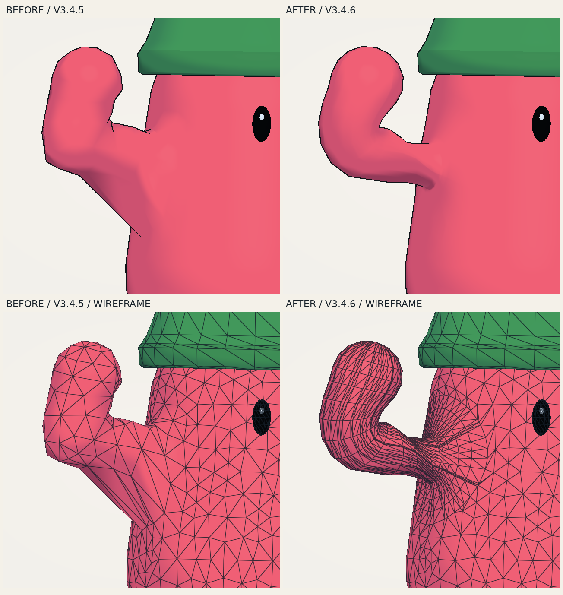

# DuderLab V3.4.6: shoulder loops

The previous weight pass reduced measured torso movement but left almost the same visible underarm flap. The feedback was correct: the attachment needed new geometry and edge flow.

## Visible result

The comparison uses the same reference recipe, wave time, camera, material, and lighting. The top pair shows the normal surface; the lower pair uses the application's actual wireframe view.

[Four-second before/after wave](media/v3-4-6-shoulder-wave.mp4) · [Front, three-quarter, and back](media/v3-4-6-shoulder-surface.png) · [Wave keyframes](media/v3-4-6-shoulder-keyframes.png)

The long rib-to-arm web is removed. A small local shading crease remains at strong bends. That remaining crease is substantially smaller than the earlier attachment and is visible in the comparison; it is not hidden by the weight display or a changed light setup.

## What was wrong

The old Cartesian Surface Nets mesh joined the descending arm capsule to the lower side of the torso. When the arm rose, a fan of triangles stretched between those low torso anchors and the moving arm. One reference edge grew from **0.1234 to 0.3885 world units**. It connected a torso vertex with approximately **4.7% arm influence** to an arm vertex with approximately **98.5%**.

The problematic patch already bridged a concave area in the bind mesh. Subdividing its existing flat triangles could add vertices without changing that attachment. The replacement moves the underarm connection upward and gives the bend explicit rings.

## Mesh construction

1. **Keep a connected torso and legs.** Surface Nets now samples that portion without the old arm branches.
2. **Cut shared shoulder boundaries.** Each elliptical socket is clipped into the torso triangles with shared intersection vertices. The existing directed boundary determines the new winding.
3. **Round into a high socket.** A pinned fillet contracts to a compact planar arm root. Matching the root plane prevents the first moving band from returning behind the socket.
4. **Build the arm with rings.** Circumferential rings follow a curved shoulder transition and continue through the upper arm, elbow, forearm, and tip. Shoulder influence follows the sweep, and the elbow blend stays continuous between rings.
5. **Preserve the authored surface.** The ring surface has a geometry tag that bypasses the old capsule-based SDF correction. It is still skinned by the same seven bones and rendered in the existing fill/outline batches.

The torso-only mesh returns all arm components to the torso while preserving its leg blend. This also keeps small clipped faces adjacent to the pinned socket from moving independently. Ring weights and their boundary copies use the same Float32-canonical position keys.

Very thin, steep arms receive an adaptive clearance constraint when the initial bend radius is smaller than the socket radius. It extends the shoulder transition where needed and limits the initial ring lean so its inner edge stays outside the socket plane. Among the reviewed recipes, this affects the two thin extremes; the reference character and all sixteen presets retain the accepted shape.

The shell already has coherent winding. Geometry assembly preserves those indices rather than flipping individual faces according to a smoothed normal. At a concave join, a shading normal is not a reliable winding oracle.

## Unity / GLB continuity

Neutral export now uses the stored coherent rest surface. Reprojecting retained torso vertices onto the old seven-part field while leaving the new rings fixed would separate the shared boundary. Posed export uses the same stored weights and geometry policy as the shader. The rig and physics still have seven bones/bodies; the additional surface tag is not another bone.

## Cost and controls

| Reference character | V3.4.5 | V3.4.6 |
| --- | ---: | ---: |
| Triangles | 3,232 | 6,268 |
| Indexed rendering vertices | 1,676 | 3,284 |
| Geometry buffer bytes | 206,384 | 403,616 |
| Scene draws, including outlines | 3 | 3 |
| Draws including GPU UI | 4 | 4 |
| Physics bodies | 7 | 7 |

The extra geometry is concentrated in the explicit arm construction. Both shape caches are bounded to 64 entries and ignore appearance-only changes. These are geometry and submission counts, not a hardware frame-rate claim.

Open `duder-lab-arm-study.html` directly in a WebGL2 browser. **Space** pauses the wave; **Pose / timeline** scrubs it; **Preview → Wireframe** shows the loops. **V** retains the optional influence view. Study edits use separate storage from the regular collection.

## Verification

The [verification directory](verification/v3-4-6/) records exact source hashes, structural mesh checks, shader/CPU agreement, application checks, and render evidence. The important geometric checks are directed edge incidence, a single closed connected body, nonzero triangle area, consistent stored weights, unchanged neutral export positions, and coincident boundary positions throughout the wave.

Transporting a bind normal by bone rotations omits the spatial change in skin weights. At a strong bend, its direction can disagree with an outward, nonintersecting surface. Normal disagreement is retained as a shading diagnostic; local intersection and inside/outside winding checks distinguish it from a real folded surface.

All comparison images and video replay the actual application shaders and mesh buffers through Mesa GLES. They are not image-generated mockups or a browser/GPU performance benchmark.

Rebuild with `python3 build.py`. The V3.4.5 comparison baseline is commit `15172b8f8f05b6b832888198d8fbc52a7029d056`.

To regenerate the close-up proof, check out that baseline and run `python3 qa/render-shoulder-closeups.py --baseline /path/to/v3.4.5 --output output/shoulder-closeups`. The full motion proof uses `python3 qa/render-arm-study.py --baseline /path/to/v3.4.5 --output output/shoulder-study --video`.
